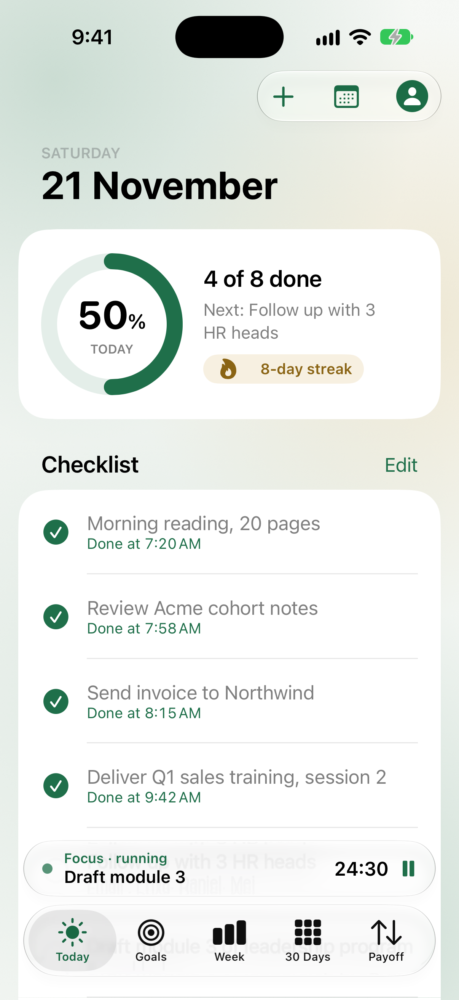
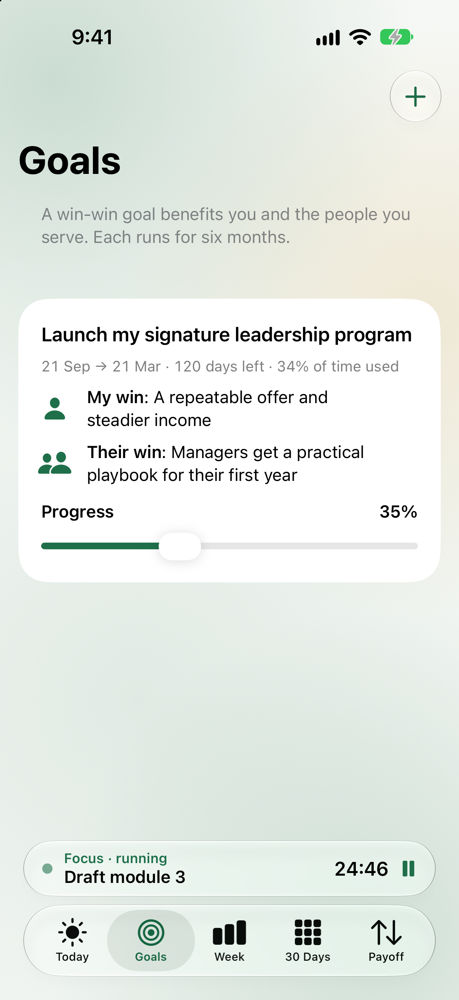
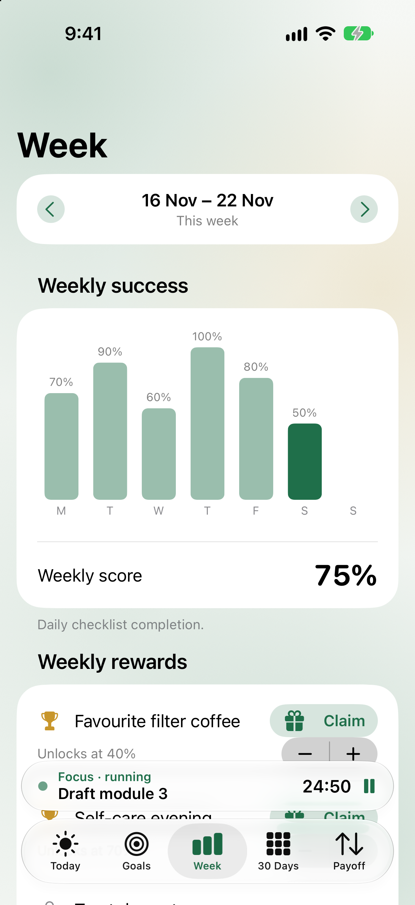
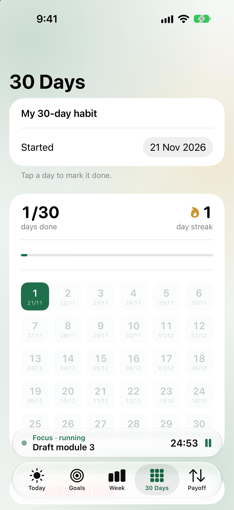
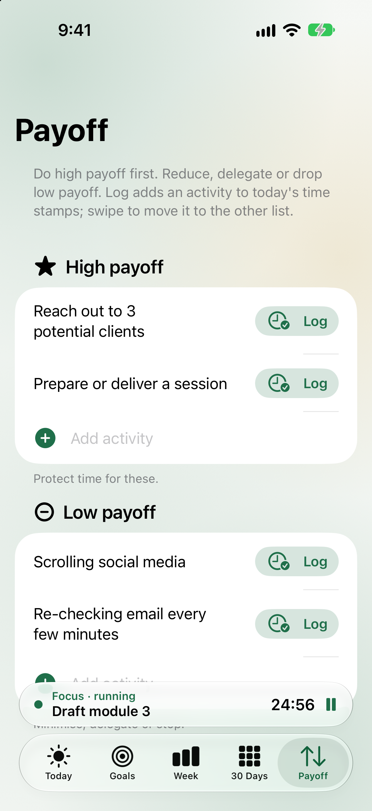
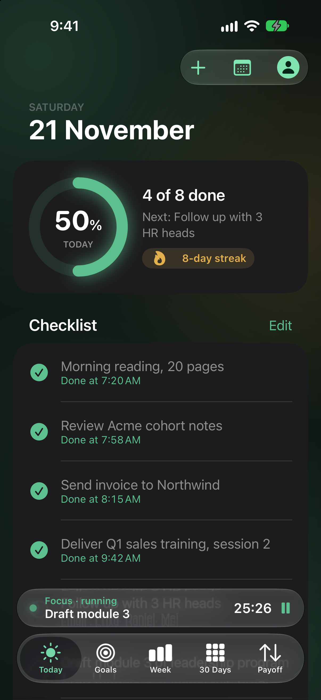
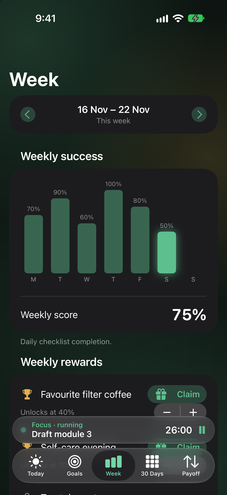
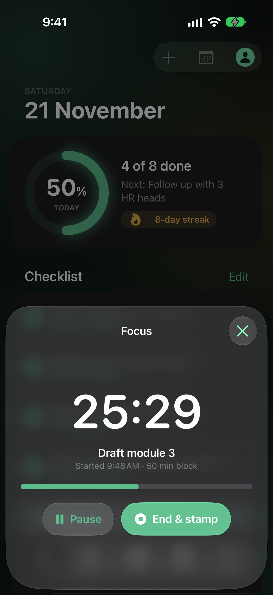

# Clarity Planner

A daily planner for iPhone, built in SwiftUI for iOS 26. Tick off a daily checklist, time-stamp your day, run focus blocks, and track six-month goals, weekly scores, a 30-day habit and high/low payoff activities.

<p>
  
  
  
  
</p>
<p>
  
  
  
  
</p>

## Features

- **Today**: progress ring, a checklist where each tick is time-stamped, a streak counted from your daily history, quick stamp chips and a "What are you doing now?" log.
- **Focus timer**: a running timer in the tab bar's bottom accessory, which opens a sheet with pause and "End & stamp".
- **Goals**: six-month win-win goals with a progress slider.
- **Week**: daily completion chart, weekly score, editable rewards that unlock at a score, and weekly achievements.
- **30 Days**: a 30-day habit grid with a streak.
- **Payoff**: high and low payoff activities that you can log into today's time stamps.
- **History and profile**: browse any past day from the calendar button; set your name (initials) and switch between System, Light and Dark appearance.
- The checklist resets at midnight, and the finished day's score is kept for the Week chart and the streak.
- All data stays on the device.

## Requirements

- Xcode 26 or later
- iOS 26 or later
- [XcodeGen](https://github.com/yonaskolb/XcodeGen) if you change `ios/project.yml`

## Run it

```bash
cd ios
xcodegen generate   # only needed after editing project.yml
open ClarityPlanner.xcodeproj
```

Pick a simulator or your iPhone and press Run. To install on a device, set your own team in `ios/project.yml` (`DEVELOPMENT_TEAM`) or under Signing & Capabilities in Xcode.

## Tests

```bash
cd ios
xcodebuild test -project ClarityPlanner.xcodeproj -scheme ClarityPlanner -destination 'platform=iOS Simulator,name=iPhone 17'
```

## Layout

- `ios/`: the SwiftUI app (`ClarityPlanner/`), its tests (`ClarityPlannerTests/`) and the XcodeGen config.
- `Clarity Planner.dc.html`, `support.js` and related files: the original design from Claude Design.
- `uploads/`: the earlier web prototype the app's features are based on.
- `screenshots/`: the images above.
